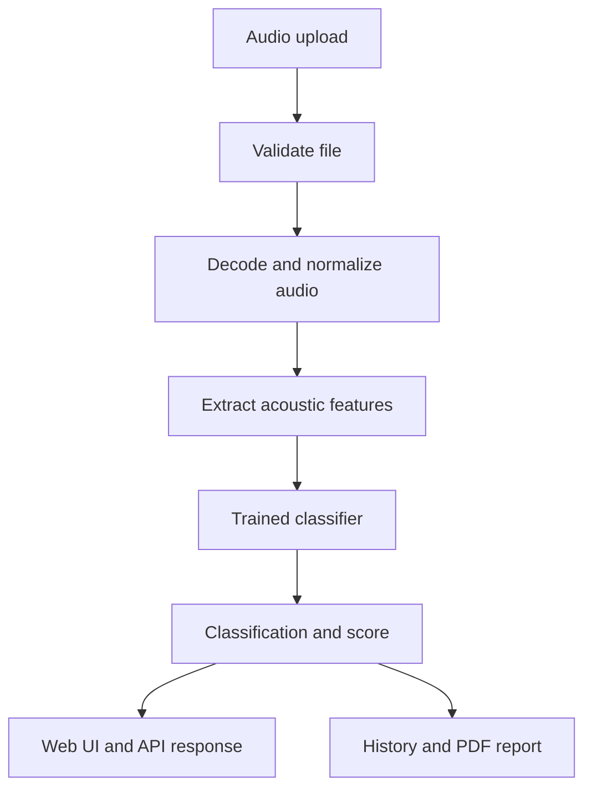

# VoxTrust — AI Voice Detection

<p align="center">
  <strong>Analyze audio for signals associated with AI-generated speech.</strong><br />
  A FastAPI-powered voice-analysis application with an interactive web interface, scan history, and downloadable reports.
</p>

<p align="center">
  <a href="https://voxtrust.themglabs.com/app"></a>
  
  
  
</p>

> **Important:** VoxTrust provides a machine-learning estimate, not proof of authenticity. Results can be affected by recording conditions, compression, unseen voice generators, and distribution shift. Do not use the output as the sole basis for legal, financial, employment, or other high-impact decisions.

## Overview

VoxTrust is a web application for examining audio and estimating whether it resembles human speech or AI-generated speech. It combines an audio-processing pipeline, feature extraction, a trained classifier, and a browser-based interface.

**Live app:** [voxtrust.themglabs.com/app](https://voxtrust.themglabs.com/app)  
**Health check:** [voxtrust.themglabs.com/health](https://voxtrust.themglabs.com/health)  
**Detailed health:** [voxtrust.themglabs.com/health/detailed](https://voxtrust.themglabs.com/health/detailed)

## Features

- **Audio analysis:** Upload supported audio files for classification.
- **Machine-learning pipeline:** Decode and validate audio, extract acoustic features, and pass them to the configured model.
- **Prediction results:** Display the model's classification and confidence score when returned by the inference pipeline.
- **Audio preview:** Preview selected audio and use playback controls where available.
- **Scan history:** Review previous scans through the API and application.
- **PDF reports:** Generate downloadable reports for supported scan workflows.
- **API endpoints:** Integrate detection, status, and history into other applications.
- **Operational safeguards:** Request validation, file-size and duration limits, rate limiting, and duplicate detection are included in the project.

Feature availability can depend on the deployed configuration and model artifacts.

## How it works

1. The user selects an audio file.
2. The backend validates the request and decodes/normalizes the audio.
3. Acoustic features, including MFCC and spectral/temporal features, are extracted.
4. The configured classifier produces a prediction and associated score.
5. The application presents the result and exposes supported history/report functionality.



## Technology stack

- **Backend:** Python, FastAPI
- **Audio processing:** librosa and supporting audio-decoding dependencies
- **Machine learning:** scikit-learn-compatible model artifacts; inspect the training pipeline for the exact estimator configuration
- **Frontend:** HTML, CSS, JavaScript
- **Deployment:** Render
- **Domain:** [voxtrust.themglabs.com](https://voxtrust.themglabs.com)

## Repository structure

```text
voice_detector/
├── api/          # API routes, validation, middleware
├── audio/        # Audio decoding and normalization
├── features/     # MFCC and acoustic feature extraction
├── models/       # Model artifacts and model-related code
├── services/     # Detection pipeline orchestration
├── utils/        # Configuration, logging, reporting, metrics
└── webui/        # HTML, CSS, JavaScript web interface

tests/             # Automated tests
scripts/           # Utility and development scripts
docs/              # Project documentation
```

## Run locally

### Requirements

- Python 3.10 or newer
- Git
- FFmpeg available on your `PATH`, if required by your audio formats/dependencies
- The model artifacts required by the application

### 1. Clone the repository

```bash
git clone https://github.com/017Mehul/ai-voice-detector.git
cd ai-voice-detector
```

### 2. Create and activate a virtual environment

**Windows (PowerShell)**

```powershell
python -m venv .venv
.venv\Scripts\Activate.ps1
```

**macOS / Linux**

```bash
python3 -m venv .venv
source .venv/bin/activate
```

### 3. Install dependencies

```bash
python -m pip install --upgrade pip
pip install -r requirements.txt
pip install -e .
```

### 4. Configure environment variables

Copy the example configuration if it exists:

```powershell
# Windows PowerShell
Copy-Item .env.example .env
```

```bash
# macOS / Linux
cp .env.example .env
```

Review `.env.example` and the application's configuration code for supported variables. Do not commit secrets or production credentials.

### 5. Start the application

```bash
python -m voice_detector.main
```

Open [http://localhost:8000/app](http://localhost:8000/app).

If the server uses a different host or port in your local configuration, use the corresponding URL.

## API overview

The application exposes versioned API routes. The main routes documented by the project are:

| Method | Endpoint | Purpose |
|---|---|---|
| `POST` | `/api/v1/detect-voice` | Submit audio for detection |
| `GET` | `/api/v1/history` | Retrieve scan history |
| `GET` | `/api/v1/status` | Inspect engine status |
| `GET` | `/health` | Basic health check |
| `GET` | `/health/detailed` | Detailed health information |

### Example detection request

The documented JSON interface accepts base64-encoded audio. Confirm the current route schema in the source before integrating against it.

```json
{
  "audio_base64": "<base64-encoded-audio>",
  "filename": "sample.wav",
  "file_format": "WAV"
}
```

Example response shape:

```json
{
  "classification": "AI_GENERATED",
  "confidence_score": 0.87
}
```

This is an **illustrative response**, not a live prediction or a guarantee that every deployment returns exactly these fields. Check the API's actual response model and headers for the deployed version.

## Privacy and persistence

Scan history and PDF report endpoints are scoped to a random, HTTP-only `voxtrust_session` cookie. This prevents one ordinary browser session from listing another session's records, but it is **not account authentication**; users who clear cookies lose access to their session history. Do not use this mechanism as a high-assurance identity system.

History is stored in a local JSON file by default. To persist it on a Render deployment, configure `VOICE_DETECTOR_HISTORY_PATH` to a path on an attached persistent disk. The current free Render service does not provide durable local-file persistence by default, so history may be lost after restarts or redeployments. Multi-instance deployments should use a shared database and distributed rate limiter.

Rate limiting ignores client-supplied `X-Forwarded-For` headers to avoid trivial IP spoofing. The ASGI server's resolved peer address is used; if accurate per-client limits are needed behind a proxy, configure a trusted proxy chain at the server/deployment layer rather than trusting arbitrary headers.

## Model evaluation and limitations

A model score should not be interpreted as a universally calibrated probability unless calibration has been validated on representative data. Performance may change across recording devices, languages, accents, codecs, background noise, and newer synthesis systems.

For a reproducible benchmark, document:

- Dataset name/version, licensing, and collection method
- Speaker-disjoint train/validation/test split
- Class balance and data-leakage controls
- Accuracy, precision, recall, F1, and confusion matrix
- Calibration evaluation and threshold-selection method
- Exact model artifact and feature-extraction configuration

No numerical performance claim is made here because it should be backed by a reproducible evaluation of the exact deployed artifact.

## Run tests

From the repository root:

```bash
python -m pytest -q
```

Use the project's test configuration and CI results to confirm the current test status.

## Deployment

VoxTrust is configured to run on Render. The public custom domain is:

- App: [https://voxtrust.themglabs.com/app](https://voxtrust.themglabs.com/app)
- Health: [https://voxtrust.themglabs.com/health](https://voxtrust.themglabs.com/health)

For a deployment update, verify the Render service's latest deployment is live, confirm the custom domain is verified, and test the health endpoint and a complete audio-analysis flow after changes.

## License

This project is licensed under the [MIT License](LICENSE).

## Author

**Mehul Gupta**  
AI/ML · Full-Stack Development · Applied Machine Learning

- GitHub: [@017Mehul](https://github.com/017Mehul)
- Project repository: [ai-voice-detector](https://github.com/017Mehul/ai-voice-detector)
